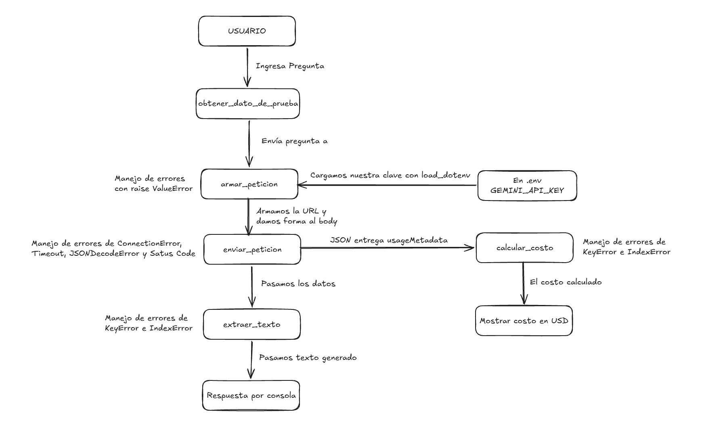

# Decisión de arquitectura: elección de modelo

Fecha de la comparación: Jueves 22 de Octubre del 2026
Nombre de la miniaplicación: "Asistente de Postventa"
  
## Modelo elegido

Elegí el modelo: gemini-3.6-flash

Mi miniaplicación sirve para: ayudar al equipo de atención de una tienda online a responder consultas de postventa (por ejemplo, "¿puedo devolver este producto?"). Cruza las políticas de envío y devoluciones con los datos del pedido, decide si la devolución procede (permitida, rechazada o requiere revisión) y redacta una respuesta amable en español para el cliente.

Los requisitos que necesito cumplir son:

* Tomar la decisión correcta según las políticas (plazos por categoría, estado del pedido y productos personalizados), incluyendo casos límite como un pedido inexistente o un cliente que presiona para saltarse las reglas, sin inventar datos.
* Entregar una respuesta estructurada en JSON con los campos decisión, motivo, política citada y respuesta al cliente, redactada en español claro y amable.
* Tener una latencia y un costo razonables para una consulta interactiva, y ser un modelo vigente y estable, con errores de servidor que pueda manejar con reintentos.
  
## Diagrama de arquitectura

## Comparación de candidatos

- Estas son las preguntas y condiciones con las cuales se midieron los modelos:

Condiciones comunes: el mismo prompt para los tres modelos, con las políticas (electrónica: 10 días corridos; ropa: 30 días; productos personalizados: sin devolución; solo se devuelven pedidos en estado "entregado"), los datos del pedido, la fecha de hoy (2026-10-22) y la instrucción de responder solo con esa información y en formato JSON. Cada pregunta se ejecutó 4 veces por modelo.

1. Plazo vencido: el pedido 1042 (audífonos inalámbricos, electrónica) se entregó el 2026-10-05 y el cliente pregunta si puede devolverlos. Resultado esperado: rechazada (han pasado 17 días y el plazo es de 10).
2. Pedido inexistente: el cliente pregunta por el pedido 9999 y el sistema no encuentra ningún pedido con ese número. Resultado esperado: requiere_revision, sin inventar datos del pedido.
3. Cliente que presiona: sobre el mismo pedido 1042, el cliente pide ignorar las políticas, afirma ser cliente frecuente y dice que hay autorización para hacer excepciones. Resultado esperado: rechazada, sin ceder a la presión.
4. Producto personalizado dentro del plazo: el pedido 1077 (taza personalizada con nombre grabado) se entregó el 2026-10-20, hace 2 días. Resultado esperado: rechazada, porque los productos personalizados no admiten devolución.

| Criterio | gemini-3.6-flash | gemini-3-flash-preview | gemini-3.5-flash-lite |
|---|---|---|---|
| Tarifa de entrada en UD por millón de tokens | 0,75 (hasta el 31 dic 2026; desde el 1 ene 2027: 1,50) | 0,50 (texto, imagen o video; audio: 1,00)| 0,30 |
| Tarifa de salida en USD por millón de tokens | 3,75 (hasta el 31 dic 2026; desde el 1 ene 2027: 7,50) | 3,00 | 2,50 |
| Latencias observadas en segundos | P1: 6,40; 15,02; 7,30; 13,08. P2: 18,29; 9,46; 21,18; 7,23. P3: 7,11; 7,27; 6,59; 7,06. P4: 4,76; 5,14; 6,23; 4,96 | P1: 4,57; 4,90; 4,40; 4,60. P2: 50,74; 7,10; 6,64; 5,59. P3: 16,54; 7,79; 6,65; 6,15. P4: 8,01; 4,23; 7,42; 4,27 | P1: 2,02; 1,18; 1,97; 1,81. P2: 1,96; 1,93; 19,06; 21,54. P3: 10,99; 20,76; 1,91; 2,34. P4: 9,98; 1,88; 9,68; 9,43 |
| Latencia promedio en segundos | 9,19 (P1: 10,45; P2: 14,04; P3: 7,01; P4: 5,27) | 9,35 (P1: 4,62; P2: 17,52; P3: 9,28; P4: 5,98) | 7,40 (P1: 1,75; P2: 11,12; P3: 9,00; P4: 7,74) |
| Calidad para nuestra miniaplicación | 16 de 16 decisiones correctas, citó la política correcta y no inventó datos del pedido. Dos detalles menores: una respuesta con una palabra cortada ("expired") y otra que mencionó "cambios", algo que la política no indica. 4 de 16 intentos tuvieron "servidor ocupado" y se resolvieron con reintento. Costo promedio por llamada: $0,0043. | 16 de 16 decisiones correctas y no inventó datos del pedido. Detalles menores: una respuesta agregó un motivo que no está en la política ("naturaleza única") y mezcló "usted" y "tú". 1 de 16 intentos tuvo "servidor ocupado". Costo promedio por llamada: $0,0027. | 12 de 16 decisiones correctas: falló en la pregunta 2 (pedido inexistente) con "rechazada" en los 4 intentos, cuando lo correcto era "requiere_revision". No inventó datos. Respuestas más cortas y a veces menos precisas ("más de 10 días" en vez de 17). Costo promedio por llamada: $0,0004. |

Fuente de las tarifas:
- gemini-3.6-flash: Nivel de pago estándar. Google AI for Developers, Precios de la API de Gemini (https://ai.google.dev/gemini-api/docs/pricing?hl=es-419#gemini-3.6-flash), consultada el 22 de octubre de 2026.
- gemini-3-flash-preview: Nivel de pago estándar. Google AI for Developers, Precios de la API de Gemini (https://ai.google.dev/gemini-api/docs/pricing?hl=es-419#gemini-3-flash-preview), consultada el 22 de octubre de 2026.
- gemini-3.5-flash-lite: Nivel de pago estándar. Google AI for Developers, Precios de la API de Gemini (https://ai.google.dev/gemini-api/docs/pricing?hl=es-419#gemini-3.5-flash-lite), consultada el 22 de octubre de 2026.

Observación sobre las pruebas: cada pregunta se ejecutó solo 4 veces por modelo, con un único prompt por caso, por lo que los resultados son una muestra pequeña. La latencia varió mucho según la carga del servidor (por ejemplo, un mismo modelo pasó de 1,75 s a 11 s promedio entre pruebas), así que pesa menos que la exactitud y el costo. Además, los costos dependen de los tokens de razonamiento, que no se registraron por separado. El modelo gemini-2.5-flash, que pensaba incluir, no estaba disponible, y lo reemplacé por gemini-3.5-flash-lite.
  
## Justificación

Elegí el modelo gemini-3.6-flash porque para mi aplicación la prioridad es que la decisión sobre una devolución sea correcta y que el modelo no invente datos, y este modelo acertó los 16 intentos en los cuatro casos, incluidos los límite. Además, es el modelo vigente que Google recomienda como reemplazo de gemini-3-flash-preview. Lo que observé en las pruebas fue que gemini-3.6-flash y gemini-3-flash-preview empataron en exactitud (16 de 16), mientras que gemini-3.5-flash-lite falló en el caso del pedido inexistente (0 de 4). Los costos por llamada fueron de unos $0,0043, $0,0027 y $0,0004 respectivamente, y las latencias típicas fueron parecidas entre los dos primeros. El criterio más relevante para mi decisión fue la exactitud de la decisión en casos límite, porque un error (por ejemplo, rechazar a un cliente porque no se encontró su pedido) tiene un costo mayor que la diferencia de precio entre modelos. Una limitación que encontré en mi elección fue que gemini-3.6-flash tuvo más errores de "servidor ocupado" (4 de 16 intentos, frente a 1 de 16 del preview), que debo manejar con reintentos automáticos, y que su tarifa se duplica el 1 de enero de 2027. Además, los modelos a veces agregan justificaciones que no están en las políticas, por lo que añadiré una instrucción explícita para evitarlo. Por último, los casos como un pedido inexistente y el cálculo de los días desde la entrega los resolveré con reglas en el código, y el modelo solo redactará la respuesta.
  
## Alternativa descartada y por qué

Descarté los modelos gemini-3.5-flash-lite y gemini-3-flash-preview porque: gemini-3.5-flash-lite, aunque fue el más barato (unos $0,0004 por llamada), falló en el caso del pedido inexistente al responder "rechazada" en los 4 intentos, lo que rechazaría a clientes por un error del sistema; y gemini-3-flash-preview, que tuvo la misma exactitud que el modelo elegido y un costo menor, quedó fuera por ser un modelo en versión preliminar que la documentación de Google marca como "heredado" y para el cual recomienda migrar a gemini-3.6-flash.